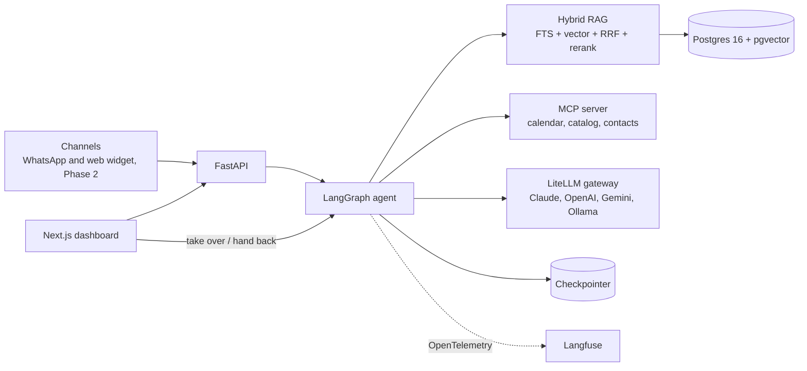

# AI Customer Service Agent Platform: Case Study

> A customer service agent for small businesses that answers only with approved, cited facts, books appointments, qualifies leads, and hands off to a human when it is not sure.
> **Source code is private.** This repository documents the project; a live walkthrough is available on request.

**Status: in development.** Phase 1 (agent, retrieval, MCP tools, evals, operator dashboard) is complete as of November 18, 2026. Phase 2 (WhatsApp Cloud API and web widget) is next. All data below comes from a fictional dental clinic.

      

## The problem

Clinics, real estate agencies, insurance brokers, and event venues answer most of their customers on WhatsApp. A human team cannot reply at 11 p.m., and generic chatbots either follow rigid menus or make things up. For a dental clinic, a confident wrong answer about a price or a procedure is worse than no answer at all.

## What I built (Phase 1)

- **Grounded answers only**: the agent replies using the business's approved knowledge base and cites the source of every claim. An answer without a source routes the conversation to a person.
- **Agent as an explicit graph**: a LangGraph state machine (understand, retrieve, answer, fact check, commit, hand off) with a Postgres checkpointer, so a conversation can pause for a human and resume later.
- **Deterministic handoff rule**: only an explicit request ("I want to talk to a person") sends the customer to a human. The model's own opinion was removed after testing showed a local model reading urgency or distrust as a request for a person.
- **Own MCP server**: scheduling, catalog, and contact tools exposed through the Model Context Protocol (FastMCP), with swappable adapters per client and a fake adapter for tests.
- **Hybrid RAG**: Portuguese full text search plus vector search, fused with Reciprocal Rank Fusion and reranked by a local cross encoder.
- **Model gateway**: LiteLLM with provider fallback (Claude, OpenAI, Gemini, and a free local model through Ollama), prompt caching, and cost recorded per conversation.
- **Evals**: simulated customers with personas, blind rubrics, and DeepEval metrics, configured to run on every pull request against recorded responses (zero paid model calls in CI).
- **Operator dashboard**: inbox, conversation view with the source of each answer, "Take over" and "Hand back" buttons, knowledge base, and cost and quality per conversation. Dark theme by default, client branding from one color token.

## Architecture

- **Single tenant by design**: each client gets its own installation (their server or a dedicated VPS) with their branding. Everything that differs between clients is configuration (a YAML file validated by Pydantic), never a fork of the code.
- **One database**: Postgres holds conversations, graph checkpoints, full text search, and vectors. A single client's knowledge base has thousands of chunks, not millions, so a dedicated vector database would add operations cost without a measurable gain.
- **Local reranker and embeddings**: no customer text leaves the client's server for retrieval, and retrieval costs nothing per query.

## Evaluation

| Metric | Value | How it is measured |
|---|---|---|
| Retrieval recall@5 | 0.962 | 60 question golden set over 268 chunks, hybrid + rerank |
| Retrieval recall@1 / MRR@5 | 0.827 / 0.904 | same golden set |
| Answers that cite a source | 100% | every answer checked for a link to a retrieved chunk |
| Faithfulness | 1.00 | DeepEval, answers against retrieved context |
| Rubric average, recorded responses | 76.3 / 100 | 5 simulated personas, blind rubrics |
| Rubric average, free local model | 63.0 / 100 | same personas, qwen3:14b on a laptop through Ollama, about 16 s per conversation |

The gap between the recorded run and the local model is documented, not hidden: the first local run scored 56.6, a node by node trace showed the cause (the understand step misreading urgency as a request for a person), and the deterministic handoff rule above raised it to 63.0.

## Scale

- ~2.9k lines of Python (agent, retrieval, gateway, MCP server)
- ~1.4k lines of TypeScript (dashboard)
- 167 Python tests passing against a real Postgres, plus Vitest and Playwright for the dashboard

## Trade-offs and limits

- pgvector is slower than a dedicated vector database at very large scale; acceptable for one business per installation.
- The local reranker adds CPU latency per question in exchange for privacy and zero cost.
- Recorded eval responses age as prompts change; re-recording is a deliberate, manual step.
- A free local model is good enough to test with, but it scores below the recorded baseline; production uses a hosted model with the local one as a last fallback.
- Not built yet: messaging channels, a queue between webhook and agent, PII masking, enforcing the per conversation cost ceiling (it is configured, not yet applied), and dashboard login. They are planned for the next phases.

## My role

Sole engineer: product definition, architecture, agent design, retrieval, MCP server, evals, observability, dashboard, and deployment tooling.

---
Built by **Victor Sestrem** · [LinkedIn](https://www.linkedin.com/in/victor-sestrem/) · victor-sestrem@hotmail.com
